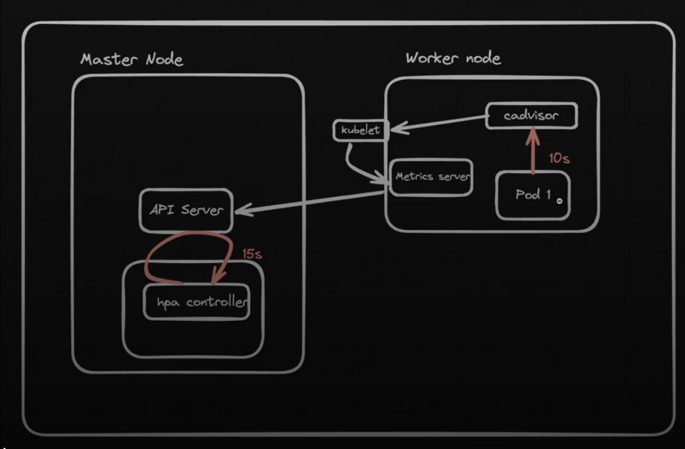

## Kubernetes Overview

- container runtime orchestration
- not worry about patching, autoscaling, observe via dashboard
- after kubernetes
  - start the clusters (cluster - bunch of machines on which kubernetes runs)
  - some machines are started as workers (1..N) and some as masters (1..)
  - pod - single pod can run multiple container - smallest unit of op in kubernetes - smallest execution unit - runs inside a node
  - cluster >> node (master(control plane)/worker) >> pod >> containers > image
  - master node - control plane
    - API Server
      - dev sends api request to this server to start containers - who are you, what do you have access to
      - by default, TCP port 6443 is exposed by the API server on the control plane nodes
    - etcd
      - key value store
      - distributed kv store - multiple master nodes can share between each other
      - tracks nodes
      - stores desired state - {pod1: {imga1:img_backend, node:worker1, }, pod2 ; {image2}}
    - kube-scheduler
      - infinite loop that checks if pods need to be started
    - kube-controller-manager
      - infinite loop
      - deployment,jobs,RS controller
  - Worker Node
    - kubelet - process that checks if pods need to deployed etc w/ API server
    - kube-proxy - handles http request to reach the actual container through the abstractions
    - container-runtime - runs container
  - kind - Kubernetes in Docker - kind create cluster --config cluster_file.yml, get cluster
  - kubectl
    - kubectl get nodes,get pods, logs `$IMAGE`, describe pods, create `$IMAGE` --port=80, run `$IMAGE` --port=80 , delete pod, apply -f deployment.yml
    - deployment - takes care of starting pods, rolling them back, updating pods, bringing them back up, rolling updates (start new, then stop update), roll back updates
      - difference between pod and deployment - deployment manages pods - creates and deletes them - pods are unit that is controlled
      - deployment creates replica sets which manages the pods, technically
      - if a pod from a created deployment is deleted, the deployment(replicaset) restarts the pod
      - kind:deployment
    - ContainerCreating, CrashLoopBackOff (app level), ErrImagePull (image level)
    - replicaset
      - ensures number of pod replicas are running
      - kind:ReplicaSet
      - replicaset scale up or down manually (not autoscaling), node autoscaling happens on the basis of the kubernetes cloud provider
      - desired, current, read
      - difference from deployment?
        - if we want to deploy a new update - delete the old rs and start a new rs with the new updated - rolling update
        - if the update fails, request hits the old rs
        - hence, deployment takes care of rolling updates
        - ramps down the old ones, ramps up the new ones,
  - Services - how to expose the app?
    - service - abstraction defining pods + policies
      - which pods can be accessed
      - how they can be accessed
      - kubectl get services
    - types
      - Loadbalancer -
        - wont run locally
        - its outside the k8s cluster - hides ip of master node
        - kubernetes lets you deploy things outside the cluster as well - like loadbalancer, on the cloud provider etc
      - ClusterIP
        - expose pods inside the cluster using an ip if another service wants to use the pods
        - only need access internally - which forwards the request - easier than the backend trying to find the pod directly as they are ephemeral
      - NodePort
        - expose the same ports of multiple nodes - to access predefined containers inside pods inside the nodes - in a load balanced fashion
        - not used in production - exposing ip of machine over internet of the machine - use loadbalancer provision outside the cluster - would have to add firewall rules to open the port - create/update firewall rule/group - open tcp port for nodeport
      - create cluster - download config which has secrets - kubectl picks from /config
    - CRI - container runtime interface - kubernetes container - supports docker and other container types
    - GKE - google kubernetes engine, EKS - elastic kubernetes service, different front ECS
    - generally, dont use kubernetes for anythign that as state (db etc) as pods are ephemeral - stateful autoscaling (e.g LLM chat) is different
    - downsides of services
      - if you have multiple applications - be + fe + ws ... - create multiple load balancers? not great - kubernetes clusters can be big
      - multiple certificates of each load balancers services - renewal every 3 months etc -
      - no centralised logic to handle rate limiting
  - Namespaces - structure pods and services better
    - kubectls get namespaces --all-namespace
    - repplying updates old deployments
    - if name/namespaces are changed - it will create a fresh deployment
    - pods in the same node can have different namespaces
    - e.g a bunch of teams running many pods on many nodes - while starting a pod - attach a namespace to it - kubectl get pods --namespace backend_team
  - helm - package manager for kubernetes
  - annotation - change some data using annotations
  - Ingress controller - ingress-managed load balancer - API object that managers external access to the services in a cluster - and may provide load balancing, SSL termination and name based virtual hosting (?)
    - client ---> LB ---> ingress managed load balancer --cluster--> Ingress--> routing rule --> service --> Pod 1..N
    - need ingress controllers with ingress
    - while bringing ingress controllers would run in a separate namespace
    - ingress is a kubernetes object - resource user creates
    - ingress controllers - nginx, traefik, haproxy
    - ingress forwards to services, not directly to pods
    - setup
      - namespace: "default" (rather than ngninx which we were setting) - externally visible
      - annotations: nginx.ingress.kubernetes.io/rewrite-target / - why? - goes to "/" endpoint - we were doing input.com/nginx which should go to "/"
      - ingressClassName - nginx - will be handled by this
      - rules - host - domain,
      - the actual paths which should route to which service
      - domain spoofing - local - on my machine point x ip to y - sudo vi /etc/hosts - point your-domain.com to ingress controller ip - to test things out locally
      - if you own the domain, manage cutom records, point the ip to the ingress controller - though dns takes time to propogate - unresolved host obtained on ping - should work after that
    - how to rate limit?
      - add a limit to global load balancer - add to annotations -e,g nginx.ingress.kubernetes.io/rps : 10
      - traefik doesnt have annotations, nginx has it
    - create deployments instead of files
    - create yaml instead of json
    - config is in version control before pushing to prod
    - don't let secrets or be in images etc! configs like - # of db instances, scrape metrics freq - should be absent from the dockerfile - is the responsibility of whoever is starting the application - e.g node/docker/kubernetes while passing the run command - on runtime
- configmaps
  - generally used for non-secret configs
  - vs secrets - secret stores from cloud providers are better - kubernetes stores in etcd database which is worse - configMap
  - file like key uses "|", vs normal property like key - multiline keys
  - kubectl get ConfigMap to list - create/delete etc, kubectl describe cm my_configmap_name
  - generally, create manifests and apply them rather than using create
  - yaml panics on random keys, convert to base64 to avoid dealing with special characters in e.g tls certs
  - secrets
- selectors
  - label is a key value pair attacehed to an object
  - selector is a condition used to find objects with matching labels
  - e.g in a service,
    - selector: backend
    - then, it targets Pods with "labels:\n\t app: backend"
  - e.g in a deployment (used differently than a service)
    - selector:\n\t matchLabels:\n\t app:backend - identfies the pods managed by the deployment
    - template.metadata.labels - defines the labels assigned to newly created pods
  - kubectl get pods --show-labels
  - kubectl get pods -l app=backend
- volumes
  - volume mount - host machine files to reach container
  - volume mounts are defined inside container, volumes are defined outside - mounting is optional. e.g on the /app folder of the docker container please mount /secret-env-file mount.
  - careful - ensure that mounts dont Override the original files - subfolder
  - volume and volumeMount are separate but correlated sections
  - check go inside - kubectl exec -it pod_name_123412 /bin/bash - and then ls,la,cat - same as docker
  - volumes in docker
    - volume mounts - data persistence - mount to volume
    - or a bind mount - to a folder on the local machine
      - docker run -v local_folder/mount:/docker_folder image_name
  - ephemeral volume -usecase - two container in a pod want to share a volume
    - emptyDir - started in a pod - all containers talk to it - when the pod dies, it dies
    - e.g deployment with one writer busybox echoing into a file, another reader busybox getting the file contents - same volumeMounts: for both and mountPath
    - under volumes - describe volumes might want to use
    - test by running - kubectl logs -f deployemnt-123 -container=reader; and then kube exec -it deplo123 sh
  - persistent volume - want to store persistent volumes in a cloud outside the cluster
  - persistent volume claim - PVC
    - request for storage by user
    - similar to pods, pods use node resources, PVC uses PV resources
    - PVCs 10gb - will look at different PVs to see if it can be claimed, if yes, it will be used - kubernetes finds the best place to bind- "i want to claim 10gb"
    - NFS - network file system - file system present somwehere, can be mounted via the network. AWS has EBS for it, "Block Storage". - create your own network server or use the one provided by the cloud provider block server - not deployed on kubernetes as we want to persist if it goes down, periodcially backup locally as well
    - the persistent volume is in the kubernetes cluster - name, capacity, access mode (read write many), storageClassName:nfs, path on the nfs, ip of the nfs
    - automatic PV creation - developer only creates the PVC, the PV automatically gets created - based on the PV, the storage is also given - storageClassName changes - check by whether the pod is running and has not errored ou
- Horizontal pod autoscaler
  - automatically controls the replicas (and hence indirectly the pods)
  - 
  - cadvisor - gets stats from pods
  - metrics server - starts from all worker nodes - has usage of pods etc
    - lightweight, in memory - add to kubernetes manually, not present by default
    - exposes details over API server in the master node
  - kind:HorizontalPodAutoscaler, scaleTargetRef:kind:Deployment
  - minReplicas:2, maxReplicas:5
  - metrics: type:Resource resource: target: type: Utilization averageUtilization: 50 -> triggers scaling
  - top or htop - cpu usage
  - ensure that after downscaling, averageUtilization is below the threshold, otherwise there is a loop of upscaling and downscaling

## Redis basics

- in memory data structure (fast) store. used as
  - in mem db
  - in mem cache
  - in mem message broker
- single threaded, - cheap and scales well
- distributed caching - different backend sevrers can have different memories - one BE's cache wont be hit if the request hits the other BE - by centralising the in mem cache via redis, the cache will hit
- in memory orderbook - how to implement? - e.g place orders quickly but should be traceable even if it goes down -
  - impl 1 - maintain a queue for every event - replay if it ever goes down - redis append only file AOF - (postgres has write ahead file)
    - queue becomes v long
  - impl 2 - fast - snapshotting
    - snapshots every hour - latest snapshots + events that came after - only
    - Point in time snapshots - Redis Database file - save every 900ms if every time event is added
- qn
  - addmin adds a new track ()
    - clear redis, put data in postgres - correct in other cases - if saving in postgres fails - data inconsistency might take place in other cases
    - update data in redis, update data in postgres
    - update data is postgres, update data in redis

## Queues

- Primary backend pushed to queue
- why queue? malicious queue shouldnt occupy primary backend, so primary backend just redirects, to a queue. workers pick from a queue, e.g lc gaurantees it is run on xyz 2 core machine - general async benefits - autoscale workers based on queue length -
- e.g rabbitmq - SQS - simple queue service

## Pub subs

- publisher subscriber
- after worker picks up, completion needs to be informed
- leetcode sends /check polling requests
- imagine a persistent connection to a websocket server
- worker shouldnt be exposed to the brower/internet - they are transitory
- use websocket <----> pub/sub <----> W1..N
- multiple websocket servers can subscribe to the same event

## Horizontal and Vertical Scaling

- node,js - single threaded - so can run on sningle processor, core - cant be scaleed - vertically
- java,golang,rust - coroutine etc parallelise - vertical scaling more effective

## Capacity estimation

- how would you scale your server, how do you handle spikes, how can you support an SLA for some traffic .
- estimate requests, monitor requests/s per machine, autoscale based on load.
  - Example-have to recover in at max x minutes to meet y SLA during z spike at an event - e.g IPL
  - e,g ipl happens twice a year
    - 10m/day = 1 server handles 1k/s, might nned 10 server
    - aggregate req/s - let central server know after 1k - tells the auto scaling group - increase to 10 servers
  - e.g chess
    - persistent connections - more expensive - metric i care is not request/s rather it is number of active users rn
    - Challenges
      - slowly drain one server which is v active - disconnect and reconnect
      - OR increase and drain if a server is reducing
  - e.g video transcoder / replit-like - take 2-3 hrs
    - mp4 -> 360,720,1080p - takes some time
    - **warm pool**
      - e.g need to provide 2gb 2cpus instantly - have a **warm pool** of servers
      - SLA - if we know we get 20 uploads / minute -- need 20 machine warm pool
        - \- lot of idle time (though relative cost might be low)
        - assigning 360p and 720p the same resources though 360p might need small
    - **queue** - push video transcoding activity
      - scale up as legnth of queue increases/decreases
      - works for video upload-as we can say "please wait for 1 hr", but for replit we cant do that "wait for replit" - so for this warm pool / kubernetes would be better

## Auto Scaling Groups - AWS feature (not containers)

- scale on the basis of parameters like - cloud provider can automatically get these, whereas the previous ones (# open requests - system dependent metric) were more adhoc and hidden from the cloud provider
  - incoming bandwidth
  - incoming request count
  - avg CPU usage of cluster
- scaling EC2 machines - takes 20-30s to start
- images, load balancer (routes - roundrobin etc - can defer to cloud provider), target group (group of EC2 to send request (not actual ip)), launch template (template to start new machines - different from image - images dont have ports, startup commands, size etc - template has image, SG, keypairs etc)
- autoscaling vs kubernetes - kubernetes is cloud agnostic
